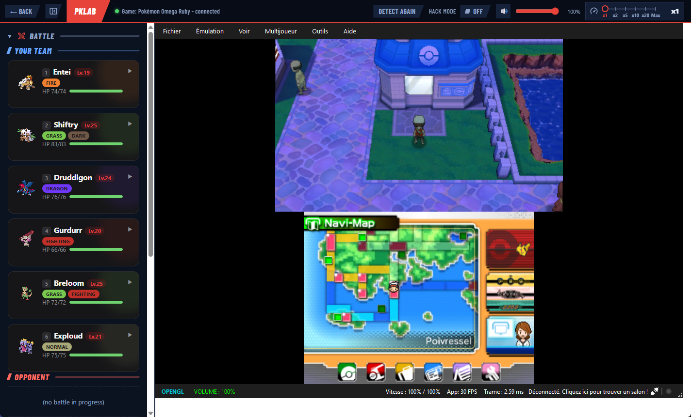
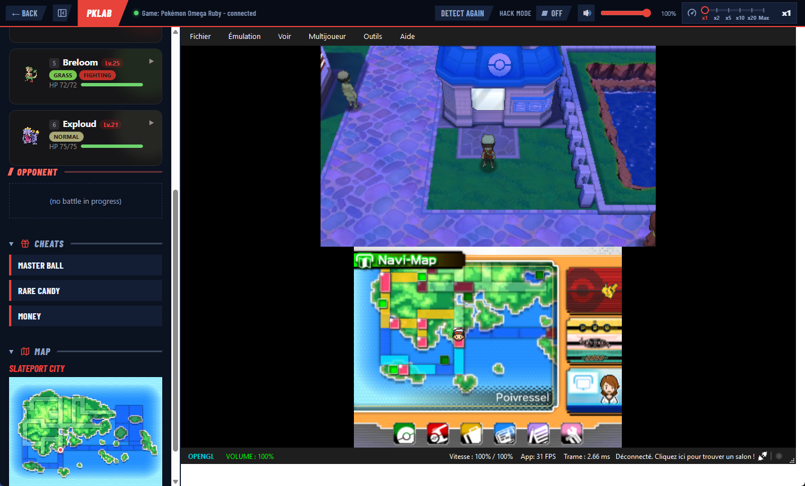
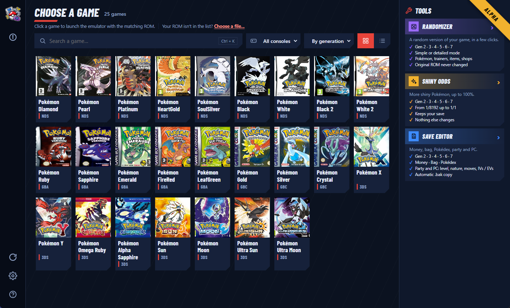
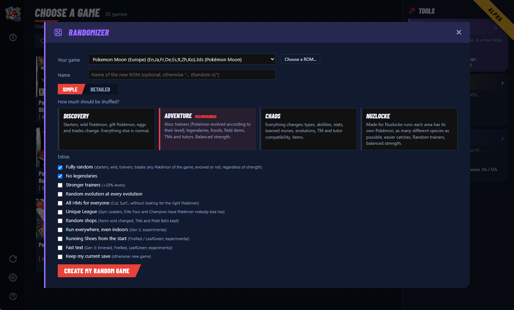
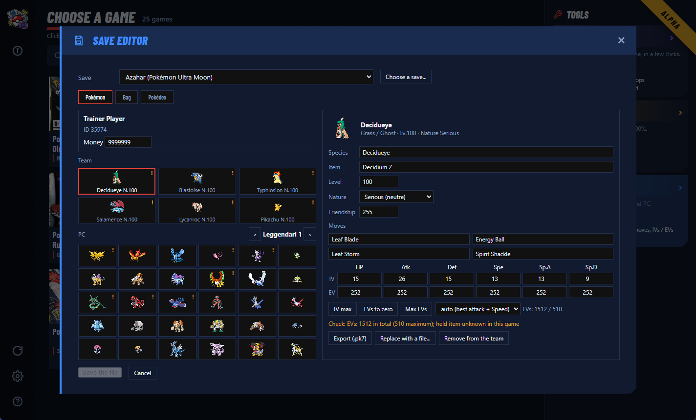

# PKLab

[](../LICENSE)

[English](../README.md) / [Français](README-fr.md) / Español

PKLab es un compañero para los juegos de Pokémon (Gen 2 a 7: Game Boy Color, GBA, DS y 3DS) jugados en emulador. Lee tu equipo y el del rival en directo desde la memoria del emulador y muestra las debilidades, las estadísticas y los movimientos. También incluye un randomizer, un editor de partidas guardadas y una herramienta de probabilidad de shiny (Gen 2 a 7), además de un control deslizante de velocidad del juego.

Descarga: [Releases](https://github.com/mrdbmyla/PKLab/releases) → `PKLab.exe` (no necesita instalación). Las ROM no están incluidas.

## Capturas de pantalla

<br>Equipo en directo, debilidades y el emulador en la misma ventana

| | |
|---|---|
| <br>Nombre de la zona y mapa de la región con tu posición | <br>Biblioteca de juegos |
| <br>Randomizer | <br>Editor de partidas |

## Licencia

Este repositorio contiene el código fuente exacto con el que se compila `PKLab.exe`. Cualquiera puede comprobar lo que hace el programa (sin virus, sin recogida de datos, etc.).
PKLab es software libre: © 2026 Mourad, publicado bajo la **Licencia Pública General de GNU v3.0** (GPL-3.0, ver [LICENSE](../LICENSE)). Puedes usarlo, estudiarlo, modificarlo y compartirlo; cualquier versión que distribuyas, modificada o no, debe seguir bajo GPL-3.0 con su código fuente. Las imágenes y nombres de los juegos y de los Pokémon pertenecen a Nintendo / The Pokémon Company y no están cubiertos por esta licencia.

Lo que hace el programa, en resumen:
- servidor local solo en `127.0.0.1:8731` (no accesible desde la red);
- lee la memoria de mGBA / melonDS (`pymem`) para mostrar tu equipo;
- 3DS: se comunica con el emulador Azahar mediante su interfaz RPC local (puerto UDP 45987 en este PC, `app/azahar_reader.py`); para los trucos de Sol / Luna / Ultrasol / Ultraluna también escribe en la memoria del proceso de Azahar (`WriteProcessMemory` de Windows). Azahar escucha en todas las interfaces de red, así que Windows puede pedir acceso a la red la primera vez: puedes rechazarlo, PKLab solo necesita la conexión local;
- conexiones a Internet (solo descargas, no se envía nada):
  - la API de GitHub de este repositorio, para las actualizaciones (`app/updater.py`); los archivos descargados se comprueban con su sha256;
  - `raw.githubusercontent.com/pret/…`: datos públicos de los mapas (`app/gen3_maps.py`, `app/gen4_maps.py`), guardados en caché;
  - `raw.githubusercontent.com/PokeAPI/sprites`: imágenes de respaldo de los Pokémon;
  - `github.com/azahar-emu/azahar/releases`: Azahar 2126.2 oficial para Windows, descargado solo la primera vez que inicias un juego de 3DS, y comprobado con su sha256 (`app/azahar_setup.py`);
  - Google Fonts: la fuente de la interfaz;
- sin telemetría, sin cuenta.

## Contenido

| Ruta | Función |
|---|---|
| `app/app.py` | bucle de lectura, servidor HTTP local, ventana (pywebview) |
| `app/nds_reader.py`, `app/games.py` | lectura de los juegos de DS (Gen 4/5) en melonDS |
| `mgba_gen2_bridge.lua` | script que se ejecuta en mGBA para los juegos de GBC (Gen 2: Oro, Plata, Cristal) |
| `mgba_gen3_bridge.lua` | script que se ejecuta en mGBA para los juegos de GBA (Gen 3) |
| `app/azahar_reader.py`, `app/azahar_setup.py` | lectura de los juegos de 3DS (Gen 6/7) en Azahar, y descarga de Azahar |
| `app/ctr_rom.py`, `app/ctr_maps.py` | lectura de los archivos ROM de 3DS (zonas, encuentros, mapas de región) |
| `app/engine.py` | decodificación de los Pokémon y cálculo de debilidades |
| `app/randomizer*.py`, `app/save_editor.py`, `app/save_gen2.py`, `app/save_gen6.py`, `app/save_gen7.py`, `app/memecrypto.py`, `app/shiny_patch.py` | herramientas |
| `app/updater.py` | actualizaciones |
| `app/rom_finder.py` | busca las ROM en el PC (solo lee la cabecera de los archivos) |
| `pklab.html`, `data/` | interfaz y datos |
| `app/PKLab.spec` | receta de PyInstaller |

## Compilar el exe uno mismo (para verificar)

Requisitos: Windows, Python 3.11, PyInstaller 6.

```bash
pip install -r app/requirements.txt pyinstaller
```

Los siguientes elementos **no** están en este repositorio y hay que añadirlos a mano antes de compilar:
- `app/mgba_bundle/mGBA.exe`: [mGBA 0.11](https://mgba.io/downloads.html) oficial para Windows (licencia MPL-2.0, [código fuente](https://github.com/mgba-emu/mgba));
- `app/melonds_bundle/melonDS.exe`: [melonDS 1.1](https://melonds.kuribo64.net/downloads.php) oficial para Windows (licencia GPL-3.0, [código fuente](https://github.com/melonDS-emu/melonDS));
- Azahar (3DS) **no** está dentro de `PKLab.exe`: lo descarga el propio PKLab (ver arriba), [versión oficial](https://github.com/azahar-emu/azahar/releases) (licencia GPL-2.0, [código fuente](https://github.com/azahar-emu/azahar));
- `boxart/` y `data/sprites/`: imágenes de los juegos y de los Pokémon (propiedad de Nintendo / The Pokémon Company, no se redistribuyen aquí y no están cubiertos por la GPL).

Después:

```bash
cd app
pyinstaller PKLab.spec --noconfirm
```

El exe se crea en `app/dist/PKLab.exe`.

Los emuladores incluidos en `PKLab.exe` son las versiones oficiales, sin modificar, de los proyectos anteriores; su código fuente está disponible en los enlaces indicados.

## Créditos

Pokémon y todos los nombres relacionados son marcas de Nintendo, Game Freak y The Pokémon Company. PKLab no está afiliado ni respaldado por ellos.
