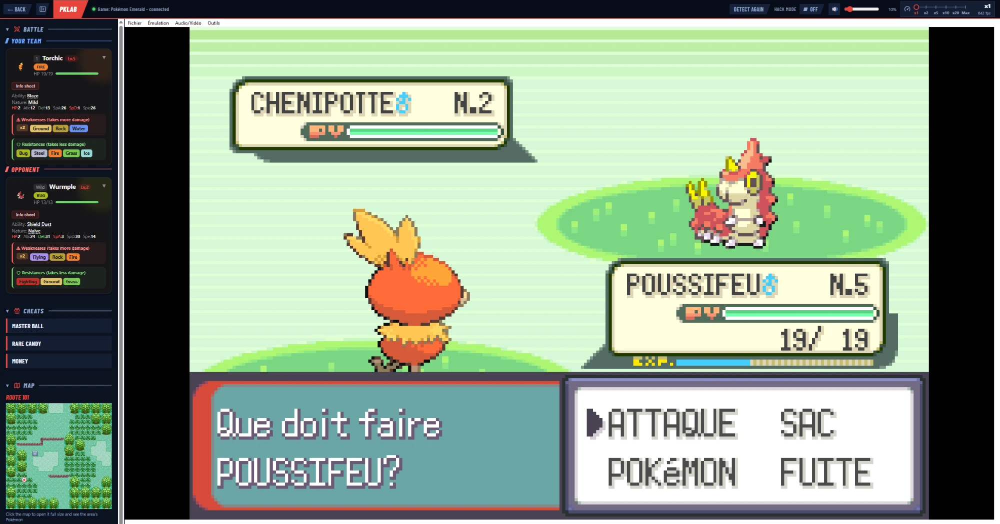
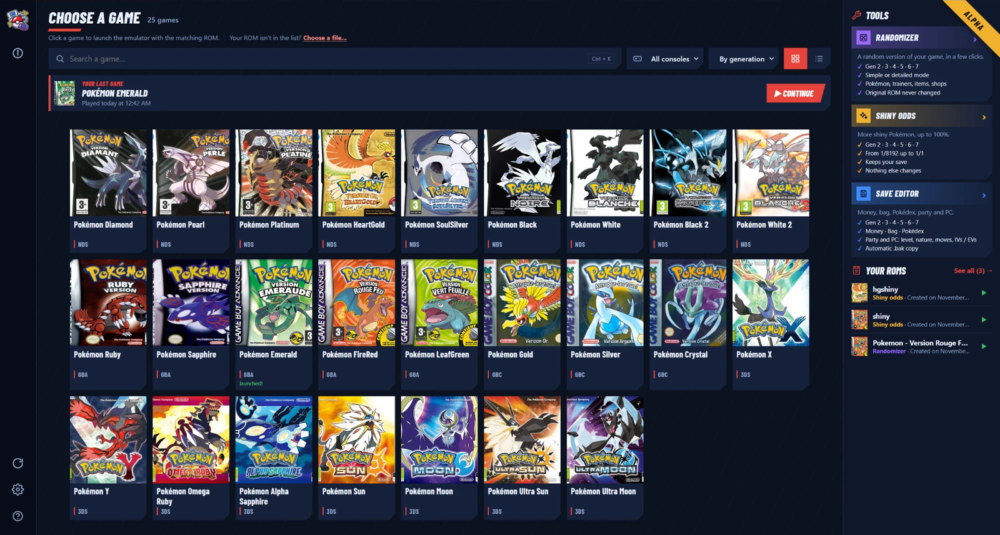
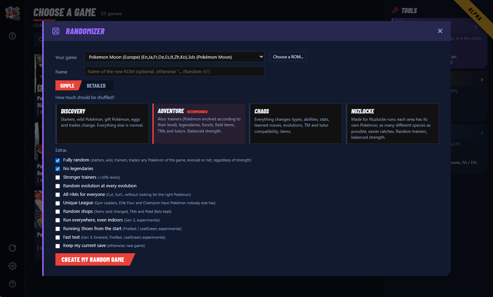
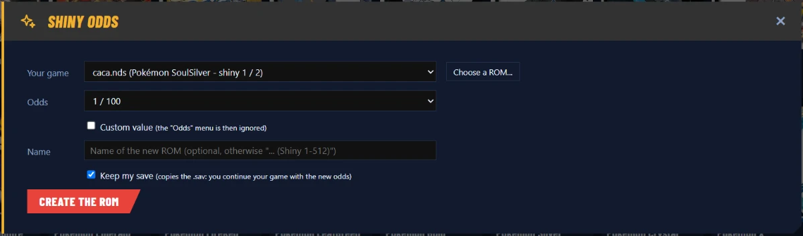
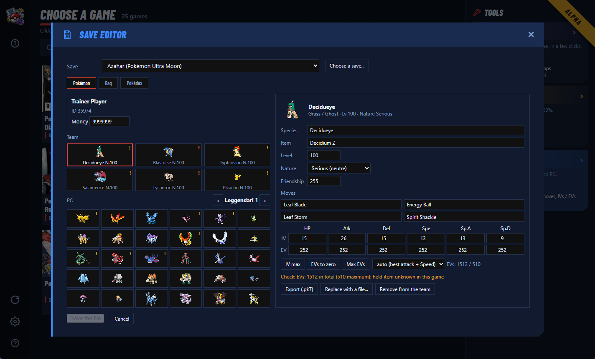

# PKLab

[](../LICENSE)

[English](../README.md) / Français / [Español](README-es.md)

PKLab est un compagnon pour les jeux Pokémon (Gen 2 à 7 : Game Boy Color, GBA, DS et 3DS) joués sur émulateur. Il lit ton équipe et l'adversaire en direct dans la mémoire de l'émulateur et affiche les faiblesses, les stats et les attaques. Il inclut aussi un randomizer, un éditeur de sauvegarde et un outil de chance de shiny (Gen 2 à 7), ainsi qu'un curseur de vitesse du jeu.

Téléchargement : [Releases](https://github.com/mrdbmyla/PKLab/releases) → `PKLab.exe` (aucune installation). Les ROM ne sont pas fournies.

## Captures d'écran

<br>Équipe en direct, faiblesses et l'émulateur dans la même fenêtre

| | |
|---|---|
| <br>Bibliothèque de jeux | <br>Randomizer |
| <br>Chance de shiny | <br>Éditeur de sauvegarde |

## Licence

Ce dépôt contient le code source exact qui sert à construire `PKLab.exe`. Chacun peut vérifier ce que fait le programme (pas de virus, pas de collecte de données, etc.).
PKLab est un logiciel libre : © 2026 Mourad, publié sous la **licence publique générale GNU v3.0** (GPL-3.0, voir [LICENSE](../LICENSE)). Tu peux l'utiliser, l'étudier, le modifier et le partager ; toute version distribuée, modifiée ou non, doit rester sous GPL-3.0 avec son code source. Les images et noms des jeux et des Pokémon appartiennent à Nintendo / The Pokémon Company et ne sont pas couverts par cette licence.

Ce que fait le programme, en bref :
- serveur local sur `127.0.0.1:8731` uniquement (inaccessible depuis le réseau) ;
- lecture de la mémoire de mGBA / melonDS (`pymem`) pour afficher ton équipe ;
- 3DS : dialogue avec l'émulateur Azahar par son interface RPC locale (port UDP 45987 sur ce PC, `app/azahar_reader.py`) ; pour les triches de Soleil / Lune / Ultra-Soleil / Ultra-Lune, écriture aussi dans la mémoire du processus Azahar (`WriteProcessMemory` de Windows). Azahar écoute sur toutes les interfaces réseau, Windows peut donc demander l'accès réseau la première fois : tu peux refuser, PKLab n'a besoin que de la connexion locale ;
- connexions Internet (téléchargements seulement, rien n'est envoyé) :
  - l'API GitHub de ce dépôt, pour les mises à jour (`app/updater.py`) ; les fichiers téléchargés sont vérifiés par leur sha256 ;
  - `raw.githubusercontent.com/pret/…` : données publiques des cartes (`app/gen3_maps.py`, `app/gen4_maps.py`), gardées en cache ;
  - `raw.githubusercontent.com/PokeAPI/sprites` : images de secours des Pokémon ;
  - `github.com/azahar-emu/azahar/releases` : Azahar 2126.2 officiel pour Windows, téléchargé seulement la première fois que tu lances un jeu 3DS, et vérifié par son sha256 (`app/azahar_setup.py`) ;
  - Google Fonts : la police de l'interface ;
- aucune télémétrie, aucun compte.

## Contenu

| Chemin | Rôle |
|---|---|
| `app/app.py` | boucle de lecture, serveur HTTP local, fenêtre (pywebview) |
| `app/nds_reader.py`, `app/games.py` | lecture des jeux DS (Gen 4/5) dans melonDS |
| `mgba_gen2_bridge.lua` | script lancé dans mGBA pour les jeux GBC (Gen 2 : Or, Argent, Cristal) |
| `mgba_gen3_bridge.lua` | script lancé dans mGBA pour les jeux GBA (Gen 3) |
| `app/azahar_reader.py`, `app/azahar_setup.py` | lecture des jeux 3DS (Gen 6/7) dans Azahar, et téléchargement d'Azahar |
| `app/ctr_rom.py`, `app/ctr_maps.py` | lecture des fichiers ROM 3DS (zones, rencontres, cartes de région) |
| `app/engine.py` | décodage des Pokémon et calcul des faiblesses |
| `app/randomizer*.py`, `app/save_editor.py`, `app/save_gen2.py`, `app/save_gen6.py`, `app/save_gen7.py`, `app/memecrypto.py`, `app/shiny_patch.py` | outils |
| `app/updater.py` | mises à jour |
| `app/rom_finder.py` | recherche des ROM sur le PC (lit seulement l'en-tête des fichiers) |
| `pklab.html`, `data/` | interface et données |
| `app/PKLab.spec` | recette PyInstaller |

## Construire l'exe soi-même (pour vérifier)

Prérequis : Windows, Python 3.11, PyInstaller 6.

```bash
pip install -r app/requirements.txt pyinstaller
```

Les éléments suivants ne sont **pas** dans ce dépôt et doivent être ajoutés à la main avant la construction :
- `app/mgba_bundle/mGBA.exe` : [mGBA 0.11](https://mgba.io/downloads.html) officiel pour Windows (licence MPL-2.0, [code source](https://github.com/mgba-emu/mgba)) ;
- `app/melonds_bundle/melonDS.exe` : [melonDS 1.1](https://melonds.kuribo64.net/downloads.php) officiel pour Windows (licence GPL-3.0, [code source](https://github.com/melonDS-emu/melonDS)) ;
- Azahar (3DS) n'est **pas** dans `PKLab.exe` : PKLab le télécharge lui-même (voir plus haut), [version officielle](https://github.com/azahar-emu/azahar/releases) (licence GPL-2.0, [code source](https://github.com/azahar-emu/azahar)) ;
- `boxart/` et `data/sprites/` : images des jeux et des Pokémon (propriété de Nintendo / The Pokémon Company, non redistribuées ici et non couvertes par la GPL).

Puis :

```bash
cd app
pyinstaller PKLab.spec --noconfirm
```

L'exe est créé dans `app/dist/PKLab.exe`.

Les émulateurs fournis dans `PKLab.exe` sont les versions officielles, non modifiées, des projets ci-dessus ; leur code source est disponible aux liens indiqués.

## Mentions

Pokémon et tous les noms associés sont des marques de Nintendo, Game Freak et The Pokémon Company. PKLab n'est ni affilié ni approuvé par eux.
