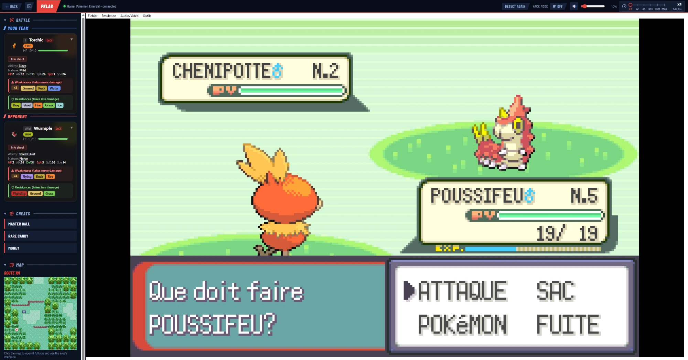
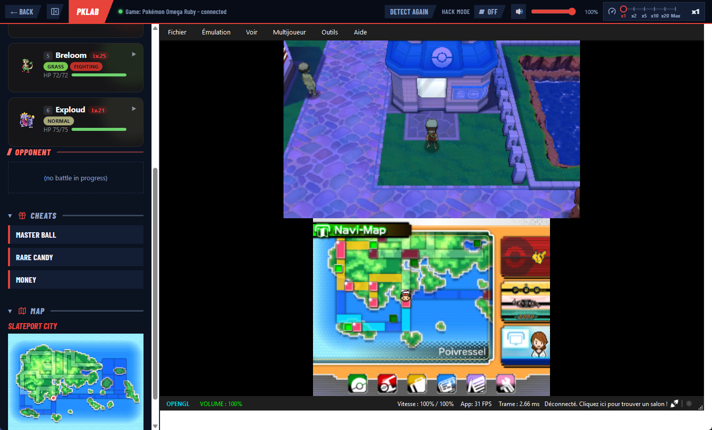
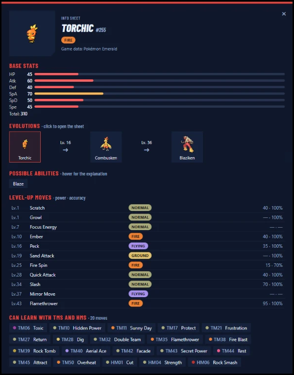
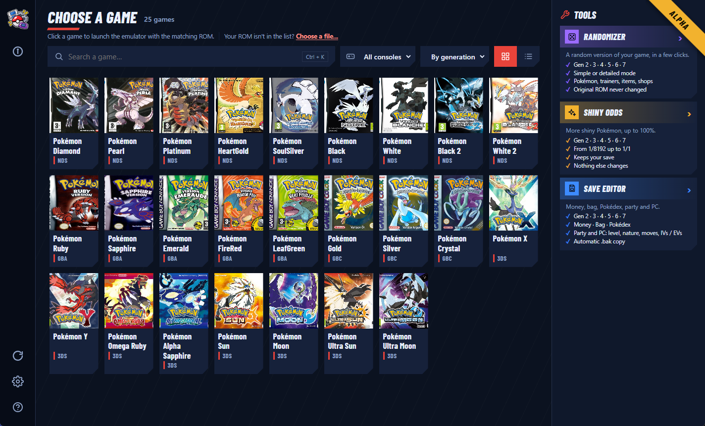
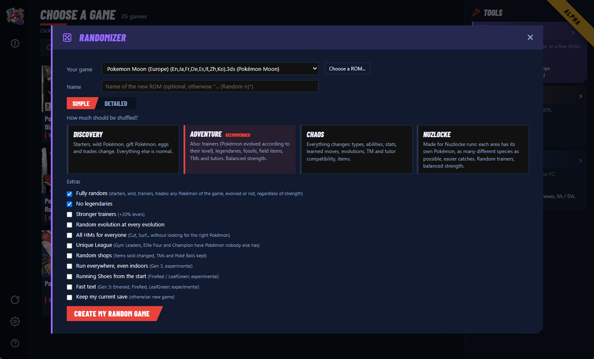
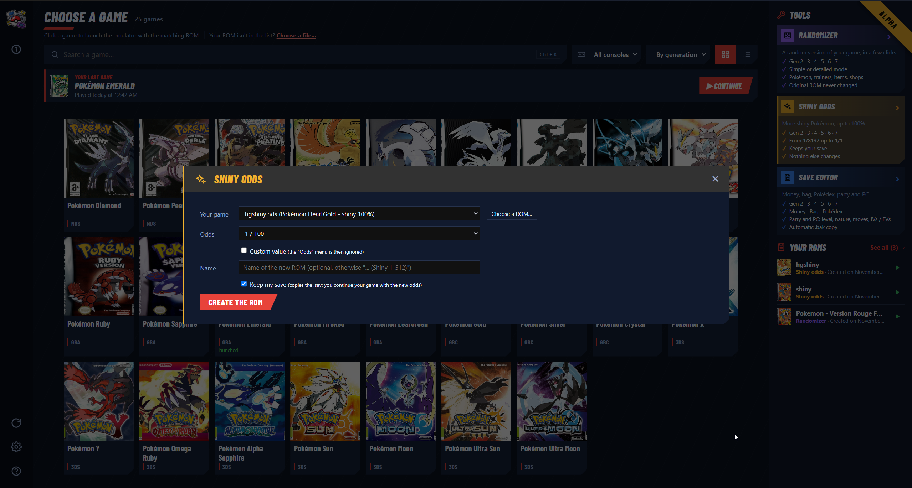
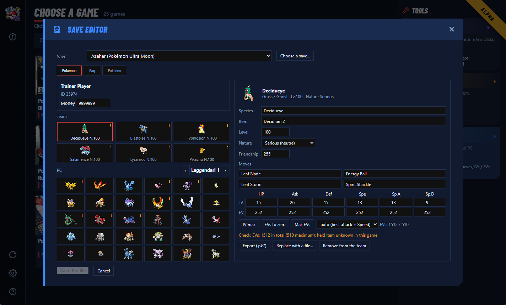

# PKLab

[](LICENSE)

English / [Français](.github/README-fr.md) / [Español](.github/README-es.md)

PKLab is a companion app for Pokémon games (Gen 2 to 7: Game Boy Color, GBA, DS and 3DS) played on an emulator. It reads your party and the opponent live from the emulator's memory and shows weaknesses, stats and moves. It also includes a randomizer, a save editor and a shiny odds tool (Gen 2 to 7), and a game speed slider.

Download: [Releases](https://github.com/mrdbmyla/PKLab/releases) → `PKLab.exe` (no installation needed). ROMs are not included.

## Screenshots

<br>Live party, weaknesses and the emulator in the same window

| | |
|---|---|
| <br>Area map with the Pokémon found there | <br>Pokémon info sheet |
| <br>Game library | <br>Randomizer |
| <br>Shiny odds | <br>Save editor |

## License

This repository contains the exact source code used to build `PKLab.exe`. Anyone can check what the program does (no malware, no data collection, etc.).
PKLab is free software: © 2026 Mourad, released under the **GNU General Public License v3.0** (see [LICENSE](LICENSE)). You may use, study, modify and share it; any version you distribute, modified or not, must also be under GPL-3.0 with its source code. Game and Pokémon images and names belong to Nintendo / The Pokémon Company and are not covered by this license.

What the program does, in short:
- local server on `127.0.0.1:8731` only (not reachable from the network);
- reads the memory of mGBA / melonDS (`pymem`) to show your party;
- 3DS: talks to the Azahar emulator through its local RPC interface (UDP port 45987 on this PC, `app/azahar_reader.py`); for Sun / Moon / Ultra Sun / Ultra Moon cheats it also writes into the Azahar process memory (Windows `WriteProcessMemory`). Azahar itself listens on all network interfaces, so Windows may ask for network access the first time: you can refuse, PKLab only needs the local connection;
- Internet connections (downloads only, nothing is sent):
  - this repository's GitHub API, for updates (`app/updater.py`); downloaded files are checked by their sha256;
  - `raw.githubusercontent.com/pret/…`: public map data (`app/gen3_maps.py`, `app/gen4_maps.py`), cached locally;
  - `raw.githubusercontent.com/PokeAPI/sprites`: fallback Pokémon images;
  - `github.com/azahar-emu/azahar/releases`: the official Azahar 2126.2 for Windows, downloaded only the first time you start a 3DS game, and checked by its sha256 (`app/azahar_setup.py`);
  - Google Fonts: the interface font;
- no telemetry, no account.

## Contents

| Path | Role |
|---|---|
| `app/app.py` | read loop, local HTTP server, window (pywebview) |
| `app/nds_reader.py`, `app/games.py` | reading DS games (Gen 4/5) in melonDS |
| `mgba_gen2_bridge.lua` | script run inside mGBA for GBC games (Gen 2: Gold, Silver, Crystal) |
| `mgba_gen3_bridge.lua` | script run inside mGBA for GBA games (Gen 3) |
| `app/azahar_reader.py`, `app/azahar_setup.py` | reading 3DS games (Gen 6/7) in Azahar, and downloading Azahar |
| `app/ctr_rom.py`, `app/ctr_maps.py` | reading 3DS ROM files (areas, encounters, region maps) |
| `app/engine.py` | Pokémon decoding and weakness calculation |
| `app/randomizer*.py`, `app/save_editor.py`, `app/save_gen2.py`, `app/save_gen6.py`, `app/save_gen7.py`, `app/memecrypto.py`, `app/shiny_patch.py` | tools |
| `app/updater.py` | updates |
| `app/rom_finder.py` | finds ROMs on the PC (reads only the file header) |
| `pklab.html`, `data/` | interface and data |
| `app/PKLab.spec` | PyInstaller recipe |

## Building the exe yourself (for verification)

Requirements: Windows, Python 3.11, PyInstaller 6.

```bash
pip install -r app/requirements.txt pyinstaller
```

The following are **not** in this repository and must be added by hand before building:
- `app/mgba_bundle/mGBA.exe`: official [mGBA 0.11](https://mgba.io/downloads.html) for Windows (MPL-2.0 license, [source code](https://github.com/mgba-emu/mgba));
- `app/melonds_bundle/melonDS.exe`: official [melonDS 1.1](https://melonds.kuribo64.net/downloads.php) for Windows (GPL-3.0 license, [source code](https://github.com/melonDS-emu/melonDS));
- Azahar (3DS) is **not** inside `PKLab.exe`: it is downloaded by PKLab itself (see above), [official release](https://github.com/azahar-emu/azahar/releases) (GPL-2.0 license, [source code](https://github.com/azahar-emu/azahar));
- `boxart/` and `data/sprites/`: game and Pokémon images (property of Nintendo / The Pokémon Company, not redistributed here and not covered by the GPL).

Then:

```bash
cd app
pyinstaller PKLab.spec --noconfirm
```

The exe is created in `app/dist/PKLab.exe`.

The emulators shipped inside `PKLab.exe` are the official, unmodified releases of the projects above; their source code is available at the links given.

## Credits

Pokémon and all related names are trademarks of Nintendo, Game Freak and The Pokémon Company. PKLab is not affiliated with or endorsed by them.
